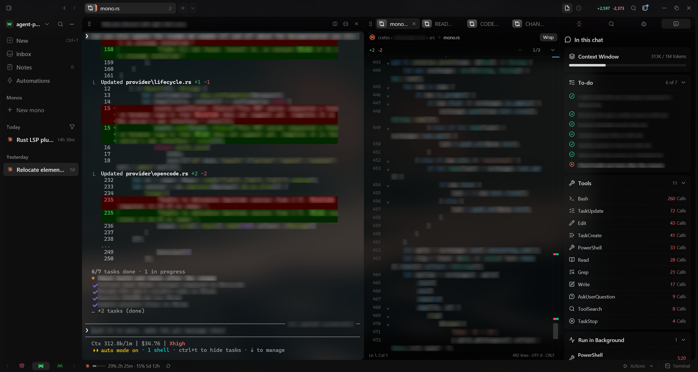

<h1 align="center">MCode</h1>

<p align="center">
  <strong>A desktop app for your coding agents, based on Monocode.</strong>
</p>

<p align="center">
  
</p>

MCode is a desktop app for the agent CLIs you already use: Claude Code, Codex, Cursor, Grok Build, OpenCode, Antigravity, Pi, omp, fx, Hermes Agent and Devin. If one is installed and logged in, MCode can run it. Every tab is a session, and the composer is its input. MCode does not sell tokens; each agent keeps using your own login.

It runs on Windows, macOS and Linux.

## Based on Monocode

MCode is a fork of **[Monocode](https://github.com/hardbeat920/monocode)** by hardbeat920.

Monocode has two desktop apps: the original React/Tauri app and **Monocode Native**, a newer app written in Rust with the GPUI framework. MCode keeps only Monocode Native and builds on it. Most of what MCode adds is for Claude Code sessions.

- Monocode's own releases, documentation and issue tracker are in the [Monocode repository](https://github.com/hardbeat920/monocode).
- Report problems with MCode's changes here. If a problem also happens in Monocode, please report it there too.
- MCode uses the same MIT licence as Monocode. See [Credits](#credits) and [License](#license).

## What MCode adds

### Claude Code panels

Claude sessions get two views in the Explorer:

- **Agents** lists the subagents a chat started, with their model, tokens, time and every step they took. It also shows the chat's estimated cost and total tokens.
- **In this chat** shows what Claude used, one box per kind:
  - **Context Window**: how full the chat's context is, such as `116K / 200K tokens`. The bar turns amber past 70% and red past 90%.
  - **To-do**: Claude's task list and how much of it is done.
  - **MCP**: the MCP servers used. Click a server to see its tools and how often each was called.
  - **Tools**: the built-in tools used, most used first.
  - **Run in Background**: commands, subagents and monitors still running, with a timer each. The box disappears when nothing is running.
  - **Files**, **Context files** and **Skills**: the files Claude read, edited or created, the instruction files it loaded (such as `CLAUDE.md`), and the skills it used.

The panels update the moment Claude writes to its chat log, without polling every second.

### Workspace

- Each split pane can open its own project panel, with its own tab, width and Git status.
- A folder box at the top of the Explorer shows any folder you type or pick, in place of the chat's own folder.
- Click the branch name at the top of **Changes** to switch branch. The list can be searched, shows local and remote branches, and creates a branch when you type a new name.
- A **Graph** section under **Changes** shows the commit history, like VS Code's Source Control graph. Drag the divider to resize it.
- The **CODE** tab next to **GRAPH** shows the project's languages, like GitHub's Languages bar. It counts the size of tracked and new files, and skips vendored code, docs and minified files.
- Opening a changed file from **Changes** is fast on Windows too. It used to take over 10 seconds there.
- Opening the app again adds a window to the running app. Windows share live sessions, so a Claude CLI runs once however many windows show it.
- The chevron next to the new-tab button starts a session on a model you pick.
- The Explorer header has no New File or New Folder buttons.

### Claude Code CLI

- The CLI view follows `/clear` and `/resume` on every platform, so the tab stays on the conversation the CLI moved to.
- Claude sessions start with Claude Code's to-do tools on (`CLAUDE_CODE_ENABLE_TODO_TOOLS=1`) unless you set that variable yourself.

### Terminal, look and Git

- Terminal programs that track the mouse receive clicks and drags.
- Ctrl+V pastes in the terminal on Windows.
- Chat backgrounds have a blur slider.
- The window can be translucent on Linux when your compositor supports it.
- MCode has its own app icon.
- Generated commit messages are short: one subject line of 50 characters or less, with a body only when a change has several parts.

## Install

There are no prebuilt MCode releases yet, so [build it from source](#build-from-source). Monocode's own packages, on the [Monocode releases page](https://github.com/hardbeat920/monocode/releases), don't include MCode's changes.

First install and sign in to at least one agent CLI. See [provider setup](docs/providers.md).

> [!WARNING]
> MCode uses your existing Monocode database and saves changes there. Back up its folder with the app closed before you try MCode, and don't edit the same conversations in Monocode and MCode at the same time.
>
> | Platform | Data folder                                           |
> | -------- | ----------------------------------------------------- |
> | Windows  | `%APPDATA%\com.monocode.desktop\`                     |
> | macOS    | `~/Library/Application Support/com.monocode.desktop/` |
> | Linux    | `~/.local/share/com.monocode.desktop/`                |

## Build from source

You need a current stable Rust toolchain from [rustup](https://rustup.rs). Each platform also needs the following:

- **Windows:** the `stable-x86_64-pc-windows-msvc` toolchain and the Visual Studio Build Tools with the **Desktop development with C++** workload. It provides the linker and the Windows SDK.
- **macOS:** Xcode with its macOS components.
- **Debian or Ubuntu:**

  ```sh
  sudo apt-get install clang cmake ninja-build pkg-config libfontconfig1-dev \
    libfreetype6-dev libxcb1-dev libxcb-shape0-dev libxcb-xfixes0-dev \
    libxcb-randr0-dev libxkbcommon-dev libxkbcommon-x11-dev libwayland-dev \
    libasound2-dev libx11-xcb-dev libegl1-mesa-dev libvulkan-dev libdbus-1-dev
  ```

Then build the app from the repository root:

```sh
cargo build --manifest-path crates/monocode-gpui/Cargo.toml --locked -p monocode-gpui --release
```

| Platform        | The app                                                 |
| --------------- | ------------------------------------------------------- |
| Windows         | `crates\monocode-gpui\target\release\monocode-gpui.exe` |
| macOS and Linux | `crates/monocode-gpui/target/release/monocode-gpui`     |

With Node.js 22+ you can also use the npm scripts:

```sh
npm run native:dev     # launch with a separate development database
npm run native:build   # build an optimized app that uses your Monocode data
npm run native:check   # run formatting, lints and tests
```

In the `native:dev` terminal, type `r` then Enter to rebuild and restart. There is no hot reload. On macOS, `native:build` makes an app bundle that is still named `Monocode Native.app`.

### Updating

Builds made from source don't update themselves. To update, pull the latest code and build again. On Windows, close MCode first, because Windows doesn't let a build replace a program that is running.

### Names you'll still see

The program file (`monocode-gpui`), the code folders and the data folders keep their Monocode names. That's why MCode can read your existing Monocode data, and why changes from Monocode are still easy to bring in.

## Guides

- [Provider setup](docs/providers.md): install and sign in to the agent CLIs
- [Building](docs/building.md): build, run and check MCode on each platform
- [Install](docs/install.md): where MCode keeps its data, and how to update
- [Native guide](docs/native/README.md): data paths, development builds, fixtures and checks
- [Agent access with /operator](docs/agent-access.md)
- [Remote sessions, experimental](docs/remote-access.md)
- [Changelog](CHANGELOG.md)

The mobile companion app, from Monocode, is a separate Expo project in [`mobile/`](mobile/README.md).

## Contributing

Bug reports and small, focused pull requests are welcome. Read [CONTRIBUTING.md](CONTRIBUTING.md) before you open one. Security problems go through [SECURITY.md](SECURITY.md).

## Credits

MCode is built on Monocode by hardbeat920 and the Monocode contributors.

## License

[MIT](LICENSE), the same licence as Monocode. Provider names and logos are trademarks of their owners. See [NOTICE](NOTICE).
